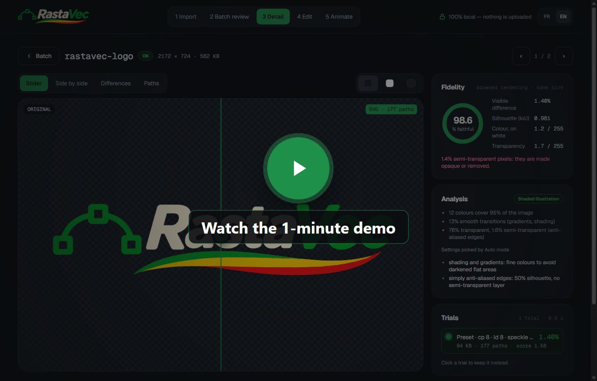

<p align="center">
  <picture>
    <source media="(prefers-color-scheme: dark)" srcset="assets/rastavec-logo.svg">
    
  </picture>
</p>

<p align="center"><b>Smooth vectors. Good vibes.</b></p>

# RastaVec

**Turn PNG, JPEG and WebP images into clean, editable SVG, and see exactly how faithful each one is.**

Drop a logo, an icon set or a whole folder of illustrations. RastaVec picks the right settings
for each image, traces it into real vector paths, then compares the SVG with the original and
retries on its own when the result is not close enough or too heavy. You get a fidelity score
for every file, a slider to check it by eye, and a zip ready to use.

<p align="center">
  <a href="https://youtu.be/fWIY1R1bUAc"></a>
  <br>
  <sub>▶ <a href="https://youtu.be/fWIY1R1bUAc">Watch the 1-minute demo on YouTube</a></sub>
</p>

- **Real vectors, not a bitmap in disguise**: every SVG is made of paths you can edit, recolour and animate.
- **Measured, not guessed**: visible difference, silhouette overlap and colour error for each image, with a magenta map of what changed.
- **Auto-tuned**: images above your difference threshold or size budget are retried with other settings; the best one wins.
- **Handles transparency**: clean silhouettes for logos and stickers, soft edges kept where they matter.
- **Batch friendly**: whole folders, sprite sheets split into one SVG per element, a summary of what needs a second look.
- **Private**: everything runs on your machine. Images are never uploaded.
- **Repeatable**: same image, same settings, same SVG, byte for byte.

## Try it

### Desktop app (beta)

Download the installer from the [latest release](https://github.com/jberdah/rastavec/releases):

| System | File |
|---|---|
| Windows 10 / 11 (x64) | `RastaVec_…_x64-setup.exe` (or the `.msi`) |
| macOS (Intel and Apple Silicon) | `RastaVec_…_universal.dmg` |

The beta is not code-signed yet. On Windows, click *More info → Run anyway*. On macOS, if the
app is blocked, open *System Settings → Privacy & Security* and click *Open Anyway*.

### Command line, for scripts and AI agents

The `rastavec` CLI uses the same engine and writes a JSON report with stable exit codes, so a
script, a CI job or a coding agent can vectorise images and check the result on its own.

```bash
npm install -g https://github.com/jberdah/rastavec/releases/download/v0.1.0-beta.1/rastavec-0.1.0.tgz
rastavec trace logo.png --compare
rastavec trace images/ -o out/ --threshold 2 --max-size 700 --json
```

All commands and options: [cli/README.md](cli/README.md).

### Web app, from source

```bash
git clone https://github.com/jberdah/rastavec.git
cd rastavec
npm install
npm run dev        # http://localhost:5173
```

## How it works

1. **Analyse**: colours, gradients and transparency tell RastaVec what kind of image it is
   (flat logo, shaded illustration, line art, pixel art, photo) and which settings suit it.
2. **Trace**: [VTracer](https://github.com/visioncortex/vtracer) turns the pixels into colour
   paths; transparent images get a separate silhouette so edges stay crisp.
3. **Compare**: the SVG is rendered at the original size and measured against the source, on
   white and on a dark background.
4. **Tune**: if an image is above the threshold or the size budget, a fixed set of alternative
   settings is tried and the best score wins.
5. **Export**: SVG files, a `metrics.csv` and a `config.json` that replays the same batch.

The interface is available in English and French.

## Contributing

Project layout, engine details, desktop builds and tests: [docs/DEVELOPMENT.md](docs/DEVELOPMENT.md).
Colours, logo files and mascot: [docs/BRAND.md](docs/BRAND.md).

## License

Code: [Apache License 2.0](LICENSE). Redistributions and derivative works must keep the
[`NOTICE`](NOTICE) file, which credits RastaVec (https://github.com/jberdah/rastavec).
The RastaVec name, logo, symbol and mascot are brand assets and are not licensed for use
beyond referring to this project. Third-party components: [THIRD_PARTY_NOTICES.md](THIRD_PARTY_NOTICES.md).
