<p align="center">
  <picture>
    <source media="(prefers-color-scheme: dark)" srcset="assets/rastavec-logo.svg">
    
  </picture>
</p>

<p align="center"><b>Smooth vectors. Good vibes.</b></p>

# RastaVec

**Turn PNG, JPEG and WebP images into clean, editable SVG, and see exactly how faithful each one is.**

Drop a logo, an icon set or a whole folder of illustrations. RastaVec picks the right settings
for each image, traces it into real vector paths, then compares the SVG with the original and
retries on its own when the result is not close enough or too heavy. You get a fidelity score
for every file, a slider to check it by eye, and a zip ready to use.

https://github.com/user-attachments/assets/1b9ad885-4589-423a-aafb-e8b841d84101

<p align="center"><sub>Also on <a href="https://youtu.be/fWIY1R1bUAc">YouTube</a></sub></p>

- **Real vectors, not a bitmap in disguise**: every SVG is made of paths you can edit, recolour and animate.
- **Measured, not guessed**: visible difference, silhouette overlap and colour error for each image, with a magenta map of what changed.
- **Auto-tuned**: images above your difference threshold or size budget are retried with other settings; the best one wins.
- **Handles transparency**: clean silhouettes for logos and stickers, soft edges kept where they matter.
- **Palette filters**: restyle a whole drawing in one click: fewer colours, less detail, hue shifts, a colour family swapped, or a theme palette (brand, duotone, mono, pastel, neon), applied to one image or the whole batch.
- **Batch friendly**: whole folders, sprite sheets split into one SVG per element, a summary of what needs a second look.
- **Animation-ready groups**: suggest nearby or spatial path groups, review their hierarchy, then edit names, roles and pivots before export.
- **Animate and export**: create keyframes, generate role-based walk cycles, or turn matching vectorized poses into a looping SVG sequence.
- **Private**: everything runs on your machine. Images are never uploaded.
- **Repeatable**: same image, same settings, same SVG, byte for byte.

## From tiny sprites to characters

These transparent CC0 PNGs, from 15 to 256 pixels, were vectorised with the CLI's default
Auto settings. Every result below is under the 3% visible-difference threshold; the measured
silhouette IoU ranges from 0.95 to 1.00. The score counts pixels whose largest channel
difference exceeds 32/255; it does not mean every channel is identical. Sources and licensing
details are in the [pixel-art fixture notes](tests/fixtures/pixel-art/README.md) and the
[grouping corpus notes](tests/fixtures/grouping-corpus/README.md).

<table>
  <thead><tr><th>Original PNG</th><th>Vector SVG</th><th>Auto result</th></tr></thead>
  <tbody>
    <tr>
      <td>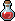</td>
      <td><a href="docs/examples/pixel-art/potion.svg"></a></td>
      <td>15 × 21 · pixel grid · 0.00% visible difference · 7.8 KiB</td>
    </tr>
    <tr>
      <td>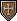</td>
      <td><a href="docs/examples/pixel-art/shield.svg"></a></td>
      <td>17 × 21 · VTracer at 4× · 0.00% visible difference · 8.9 KiB</td>
    </tr>
    <tr>
      <td>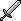</td>
      <td><a href="docs/examples/pixel-art/sword.svg"></a></td>
      <td>21 × 21 · pixel grid · 0.00% visible difference · 5.3 KiB</td>
    </tr>
    <tr>
      <td>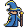</td>
      <td><a href="docs/examples/pixel-art/tiny-wizard.svg">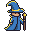</a></td>
      <td>32 × 32 · VTracer at 4× · 0.00% visible difference · 16.7 KiB</td>
    </tr>
  </tbody>
</table>

### Larger illustrations

The same workflow handles shaded characters and detailed icons. The vector remains editable,
though larger drawings can contain many paths; high visual fidelity does not by itself make a
file ready for rigging or animation.

<table>
  <thead><tr><th>Original PNG</th><th>Vector SVG</th><th>Auto result</th></tr></thead>
  <tbody>
    <tr>
      <td>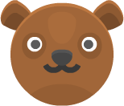</td>
      <td><a href="docs/examples/illustrations/kenney-bear.svg">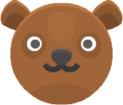</a></td>
      <td>154 × 132 · VTracer at 4× · 0.74% visible difference · 63.6 KiB · 1,064 paths</td>
    </tr>
    <tr>
      <td>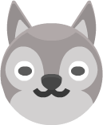</td>
      <td><a href="docs/examples/illustrations/kenney-dog.svg">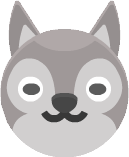</a></td>
      <td>129 × 157 · VTracer at 4× · 0.54% visible difference · 70.9 KiB · 1,214 paths</td>
    </tr>
    <tr>
      <td>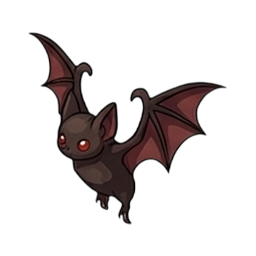</td>
      <td><a href="docs/examples/illustrations/bat.svg">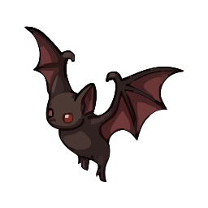</a></td>
      <td>256 × 256 · VTracer · 2.71% visible difference · 31.3 KiB · 68 paths</td>
    </tr>
    <tr>
      <td>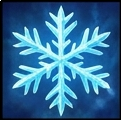</td>
      <td><a href="docs/examples/illustrations/spell.svg">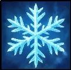</a></td>
      <td>121 × 120 · VTracer at 2× · 2.76% visible difference · 166.3 KiB · 1,779 paths</td>
    </tr>
  </tbody>
</table>

## Group and animate

RastaVec can group paths by proximity and SVG order, or propose spatial regions when related
paths are far apart in the SVG. These are geometric suggestions, not recognized body parts or
objects: inspect them, then rename, merge or split groups and assign optional roles and pivots.
The group names, roles and pivots are included in the SVG and ZIP metadata.

The animation editor supports editable pivots, keyframes for rotation and vertical movement,
role-driven walk cycles, and looping pose sequences made from vectorized images with matching
dimensions. Review the motion before using the exported SVG in a project.

## Try it

### Desktop app (beta)

Download the installer from the [latest release](https://github.com/jberdah/rastavec/releases):

| System | File |
|---|---|
| Windows 10 / 11 (x64) | `RastaVec_…_x64-setup.exe` (or the `.msi`) |
| macOS (Intel and Apple Silicon) | `RastaVec_…_universal.dmg` |

The beta is not code-signed yet. On Windows, click *More info → Run anyway*. On macOS, if the
app is blocked, open *System Settings → Privacy & Security* and click *Open Anyway*.

### Command line, for scripts and AI agents

The `rastavec` CLI uses the same engine and writes a JSON report with stable exit codes, so a
script, a CI job or a coding agent can vectorise images and check the result on its own.

```bash
npm install -g https://github.com/jberdah/rastavec/releases/download/v0.4.0-beta.1/rastavec-0.4.0-beta.1.tgz
rastavec trace logo.png --compare
rastavec trace images/ -o out/ --threshold 2 --max-size 700 --json
```

All commands and options: [cli/README.md](cli/README.md).

### Web app, from source

The generated VTracer-Next WebAssembly module is included for normal app builds. Rust and
`wasm-pack` are needed only when rebuilding the engine from the private Next checkout; see the
[development setup](docs/DEVELOPMENT.md).

```bash
git clone https://github.com/jberdah/rastavec.git
cd rastavec
npm install
npm run dev        # http://localhost:5179
```

## How it works

1. **Analyse**: colours, gradients and transparency tell RastaVec what kind of image it is
   (flat logo, shaded illustration, line art, pixel art, photo) and which settings suit it.
2. **Trace**: the local VTracer-Next fork turns the pixels into colour paths. RastaVec measures
  every result against its source, including transparent images, so its existing detail and
  auto-tune controls continue to guide the output. The browser, desktop app and CLI share the
  same Rust engine compiled to WebAssembly.
3. **Compare**: the SVG is rendered at the original size and measured against the source, on
   white and on a dark background.
4. **Tune**: if an image is above the threshold or the size budget, a fixed set of alternative
   settings is tried and the best score wins.
5. **Export**: SVG files, a `metrics.csv` and a `config.json` recording the settings used. The app does not yet import this configuration to replay a batch.

The interface is available in English and French.

## Contributing

Project layout, engine details, desktop builds and tests: [docs/DEVELOPMENT.md](docs/DEVELOPMENT.md).
Colours, logo files and mascot: [docs/BRAND.md](docs/BRAND.md).

## License

Code: [Apache License 2.0](LICENSE). Redistributions and derivative works must keep the
[`NOTICE`](NOTICE) file, which credits RastaVec (https://github.com/jberdah/rastavec).
The RastaVec name, logo, symbol and mascot are brand assets and are not licensed for use
beyond referring to this project. Third-party components: [THIRD_PARTY_NOTICES.md](THIRD_PARTY_NOTICES.md).
