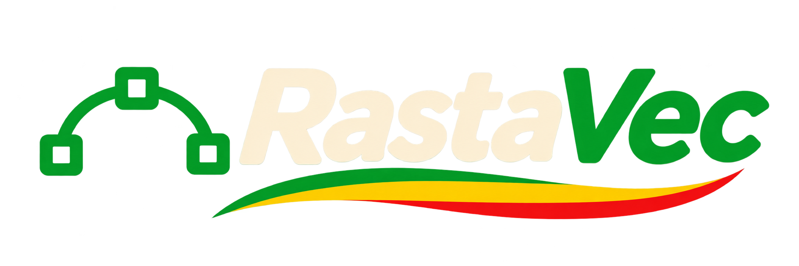

<p align="center"></p>

<p align="center"><b>Smooth vectors. Good vibes.</b></p>

# RastaVec

*(Formerly "SVG Studio". The name RastaVec is provisional until domain and trademark checks are done.)*

Vectorise PNG/JPEG/WebP images into editable SVG, compare each result with its source and
tune it automatically, deterministically, 100 % in the browser (images never leave the device).

POC status: **Import → batch review → detail/compare → export** work. Colour editing and
animation are mocked up but not implemented yet.

## Run

```bash
npm install
npm run dev        # http://localhost:5173
npm run build      # static site in dist/
npm run check      # svelte-check + tsc
```

## Command line (for scripts and AI agents)

The [`cli/`](cli) package provides `rastavec trace | analyze | slice` with a JSON report
(`report.json`, `--json`), comparison images (`--compare`) and stable exit codes
(0 ok, 1 needs review, 2 error). It reuses the same engine as the web app. See [cli/README.md](cli/README.md).

```bash
cd cli && npm install && npm run build
node dist/rastavec.cjs trace ../assets -o out --threshold 2 --max-size 700 --compare --json
```

## How it works

```
src/lib/engine/core.ts             pure TS, no DOM: prepare (alpha floor, keying, silhouette mask),
                                   metrics, diff map, auto-tune grid, scoring, choice
src/lib/engine/browser-backend.ts  TraceBackend for the browser: vtracer-webapp (wasm) + canvas
src/lib/engine/presets.ts          presets, same parameter units as the raster-to-svg skill
src/lib/engine/analyze.ts          image analysis (colours, gradients, alpha) -> Auto parameters
src/lib/engine/compact.ts          compact path encoding (pure, deterministic)
src/lib/engine/compose.ts          SVG assembly shared by backends (silhouette clip, soft layers, binary)
src/lib/engine/vectorize.ts        shared loop: analysis -> trace -> measure -> auto-tune -> choice
src/lib/engine/slice.ts            sprite-sheet / brand-board slicing into elements (pure)
src/lib/i18n.svelte.ts             FR / EN dictionaries, locale detection, number / size formatting
src/lib/pipeline.ts                per-image pipeline: decode → trace → render → measure → auto-tune
src/lib/export.ts                  zip: svg/*.svg, metrics.csv, config.json (replays the batch)
src/lib/views/*                    Import, Lot (batch), Detail screens (Svelte 5)
```

- **Engine**: [VTracer](https://github.com/visioncortex/vtracer) via the official
  `vtracer-webapp` wasm build (MIT/Apache-2.0). It needs DOM elements, so it runs on the main
  thread, time-sliced to keep the UI responsive.
- **Transparency**: transparent pixels are keyed, then the colour result is clipped by a
  silhouette traced separately from the alpha channel (alpha ≥ 128 by default, configurable),
  the two-pass technique validated on the Brainclaw avatars. Soft edges / translucent areas
  below the cut are traced in colour at their mean opacity (or as uniform alpha bands);
  fully semi-transparent artwork keeps its mean opacity.
- **Analysis & Auto preset**: dominant colours, gradients and alpha profile classify each image
  (flat logo, shaded illustration, line art, pixel art, photo) and pick its parameters.
- **Metrics** (identical to the skill's `compare.cjs`): silhouette IoU at alpha ≥ 128,
  mean colour difference on white and on #202020 (0–255), alpha difference, and
  `pct_pixels_diff_gt_32`, the share of visibly different pixels used for ranking.
- **Compact output**: paths are re-encoded (translate baked in, relative coordinates computed
  from rounded points, shortest numbers, implicit repeated commands): about 27 % smaller with
  identical fidelity metrics (sub-pixel rounding only). See `src/lib/engine/compact.ts`.
- **Sheet slicing** ("Découper une planche"): a transparent (or uniform-background) board is
  split into one image per element: connected components, small decorations attached to the
  nearest element, letters of a wordmark grouped, reading order kept. Boards with background
  panels behind groups of items are split per panel.
- **Auto-tune**: when an image exceeds the difference threshold or the size budget, a fixed
  grid of up to 6 parameter sets is tried; the best score (`% diff + 0.002 × KiB`) within the
  budget wins. Same input + same config → byte-identical SVG.

## Localisation

The UI is available in French and English. The default follows the browser language; the
FR / EN switch in the header remembers the choice (localStorage). Numbers, percentages and
sizes are formatted per locale (`1,25 %` / `1.25%`, `Ko` / `KB`). The engine is
language-neutral: analysis and Auto return codes (`kind`, `alpha`, note codes) that the UI
translates, so the same core can serve a CLI. To add a language, add a dictionary in
`src/lib/i18n.svelte.ts` (the `en` object is typed against the French keys).

## Brand

- Name `RastaVec`, CLI / packages `rastavec`; signature *Smooth vectors. Good vibes.*
- App: minimal, background `#0A0B0F`, accent = logo green `#1F8F4A` for fills (dark text on it),
  lighter tint `#3CC274` for text and thin strokes on the dark UI. Brand palette green `#1F8F4A`,
  gold `#FFD34D`, red `#E74A3B`, orange `#FF8A28`, cream `#FFF8E6`, used sparingly in the app
  (marketing and illustrations first).
- **Magenta `#FF4F8B` is the alert colour** (differences, items to review, diff map): it is
  outside the brand palette and never decorative.
- Logo: minimal Bézier symbol + wordmark (must work monochrome at 16 px). The mascot (striped
  beanie and headphones, no dreadlocks) is separate, for large formats, empty states and
  animation. Brand source images live in `assets/`.

## CI and desktop builds (GitHub Actions)

- **CI** (`.github/workflows/ci.yml`): on every push to `main` and every pull request,
  type-check and web build on Linux, plus the CLI build and smoke test.
- **Desktop apps** (`.github/workflows/desktop.yml`): Tauri build for **Windows (x64)** and
  **macOS (universal: Intel + Apple Silicon)**. Run it from the Actions tab ("Run workflow")
  to get the installers as artifacts (`.msi`, `-setup.exe`, `.dmg`); push a tag `v*`
  (e.g. `git tag v0.2.0 && git push --tags`) to also get a draft GitHub release.
  Builds are not code-signed yet (SmartScreen / Gatekeeper warn on first launch).
- **Desktop end-to-end test** (same workflow, Windows): installs the NSIS build silently and
  checks that it starts, then drives a test variant of the app (same code, WebView2 debugging
  port via `e2e/tauri.e2e.conf.json`) with Playwright over CDP: import, vectorise, batch review,
  detail view, slider, metrics. Screenshots, a screen recording and `report.json` are in the
  `e2e-desktop-windows` artifact, with a summary on the run page.
- **macOS end-to-end test**: installs the `.dmg`, checks the app starts, then runs a test
  variant built with `VITE_E2E_PORT` (WKWebView cannot be driven over CDP): an in-app harness
  (`src/lib/e2e-harness.ts`, absent from normal builds) drives the same UI and reports each step
  to `e2e/desktop-mac.mjs`, which takes screenshots and checks the results (`e2e-desktop-macos`).
  The draft release waits for both tests.

Locally: `npm run tauri dev` / `npm run tauri build` (needs Rust and, on Windows, the C++
build tools).

## Distribution

The engine core is environment-agnostic on purpose: the same `TraceBackend` contract can be
implemented by a native backend (VTracer Rust/Python + sharp) to ship a CLI / MCP server for
coding agents, or a desktop shell (e.g. Tauri) reusing this UI.

Web hosting target: Cloudflare Pages project `rastavec` (domain to be decided):

```bash
npm run deploy     # build + wrangler pages deploy (needs a Cloudflare login)
```

## Local test material

Put sample images in `.tmp/` (git-ignored). In dev (or with `?debug`), `window.rastavec` exposes `addFiles`,
`processAll` and the app state for scripted checks.

## License

Code: [Apache License 2.0](LICENSE). Redistributions and derivative works must keep the
[`NOTICE`](NOTICE) file, which credits RastaVec (https://github.com/jberdah/rastavec).
The RastaVec name, logo, symbol and mascot are brand assets and are not licensed for use
beyond referring to this project. Third-party components: [THIRD_PARTY_NOTICES.md](THIRD_PARTY_NOTICES.md).
