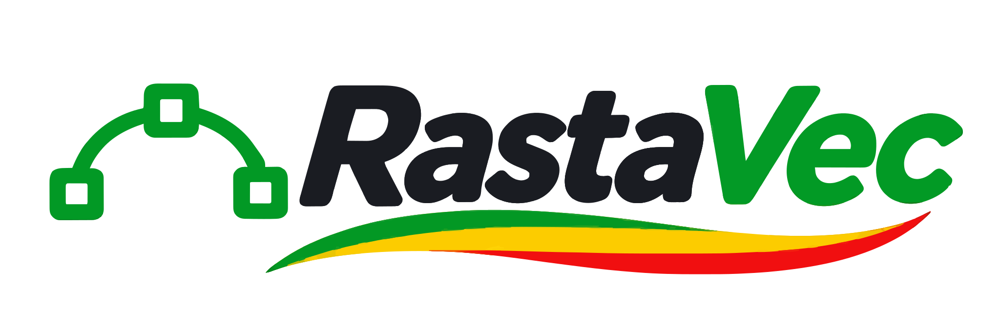

<p align="center">
  <picture>
    <source media="(prefers-color-scheme: dark)" srcset="https://raw.githubusercontent.com/jberdah/rastavec/main/assets/rastavec-logo.svg">
    
  </picture>
</p>

# RastaVec CLI

> Smooth vectors. Good vibes.

Raster to SVG from the command line: image analysis, fidelity metrics and deterministic
auto-tuning, with a JSON report and stable exit codes for scripts, CI and AI agents.
Same engine as the [RastaVec web app](https://github.com/jberdah/rastavec), everything runs locally.

```bash
rastavec trace logo.png
rastavec trace images/ -o out/ --preset auto --threshold 2 --max-size 700 --compare --json
rastavec analyze images/ --json        # what Auto would do, writes nothing
rastavec slice board.png -o elements/   # one PNG per element of a sprite sheet
```

## Install

This checkout requires Node.js 22 or later. The published beta is attached to the
[GitHub releases](https://github.com/jberdah/rastavec/releases):

```bash
npm install -g https://github.com/jberdah/rastavec/releases/download/v0.5.0-beta.1/rastavec-0.5.0-beta.1.tgz
```

## Commands

| Command | What it does |
|---|---|
| `trace <input...>` | Vectorise files and/or folders. Writes `<name>.svg` and `report.json` to the output folder. |
| `analyze <input...>` | Classifies each image (flat logo, shaded illustration, line art, pixel art, photo), detects transparency, prints the parameters Auto would use. |
| `slice <sheet>` | Splits a transparent or uniform-background sheet into one PNG per element. |

## Trace options

| Option | Default | Meaning |
|---|---|---|
| `-o, --out <dir>` | `./rastavec-out` | output folder |
| `-p, --preset <id>` | `auto` | `auto`, `flat`, `shaded`, `line`, `pixel`, `custom` |
| `--gradients` | off | force experimental gradient fitting in color traces; Auto may compare one optional gradient trial on suitable shaded images without this flag |
| `-t, --threshold <pct>` | `3` | max share of visibly different pixels |
| `-s, --max-size <KB>` | `0` | optional size budget per SVG (KiB); `0` sets none |
| `--no-auto` | | single trial, no auto-tuning |
| `--compare` | | also write `<name>.comparison.png` (source / SVG on white and dark) and `<name>.diff.png` (differences in magenta) |
| `--diff-summary-json` | | write `<name>.diff.json` with an 8×8 visible-difference grid and up to eight hotspot regions; also embed the summary in each JSON report item |

There is no size budget by default: the Auto score already weighs size against
fidelity and editability. When a budget is set, it guides Auto selection and
marks outputs for review; it does not prevent exporting a larger SVG. If every
regular Auto candidate for a photograph is over budget (or above 400 KiB when no
budget is set), Auto measures two simpler variants and selects from the actual
rendered results. A photograph may remain above the visible-difference target.
| `--slice` | | treat inputs as sheets and vectorise each element |
| `-r, --recursive` | | include sub-folders |
| `-f, --force` | | overwrite existing outputs (never overwritten otherwise) |
| `--color-precision`, `--layer-difference`, `--speckle`, `--mode`, `--binary` | | parameter overrides (custom preset) |
| `--clustering <color-cluster|watershed>` | `color-cluster` | choose the colour-region clustering method |
| `--watershed-detail <0-255>` | `128` | Watershed cut detail; selecting it also enables Watershed |
| `--json` | | JSON report on stdout |
| `-q, --quiet` | | no progress output |

From the repository root, build the CLI and run it with experimental gradients.

```bash
npm --prefix cli run build
node cli/dist/rastavec.cjs trace illustration.png --preset shaded --gradients --json
```

The `line` preset and `--binary` keep gradient fitting off. With the `auto`
preset, gradient fitting is available for images traced in color.

Before tracing, all output paths, including `report.json` and optional comparison images,
are checked for existing files. Output names are made unique within a batch, including when
an input name already contains a numeric suffix. A sheet with no detected elements is an
error (exit code 2), rather than a successful empty batch. `slice` checks every element's
destination before writing any of them. Even with `--force`, `trace` refuses to write an
output over one of its input images.

## Exit codes

| Code | Meaning |
|---|---|
| `0` | every image is under the threshold and the size budget |
| `1` | at least one image needs review |
| `2` | error: bad arguments, unreadable input, existing outputs without `--force` |

## JSON report (`schemaVersion: 1`)

```json
{
  "schemaVersion": 1, "tool": "rastavec", "version": "0.5.0-beta.1",
  "engine": "VTracer-Next", "traceEngine": "next", "experimentalGradients": false,
  "settings": { "preset": "auto", "params": null, "autoTune": { "enabled": true, "threshold": 2, "maxKB": 700 } },
  "summary": { "total": 4, "ok": 2, "review": 2, "errors": 0, "seconds": 51.2 },
  "items": [{
    "name": "logo", "input": "…/logo.png", "output": "…/logo.svg",
    "comparison": "…/logo.comparison.png", "diff": "…/logo.diff.png",
    "status": "ok", "width": 2172, "height": 724,
    "analysis": { "kind": "shaded", "alpha": "edges", "dominantColors": 12, "gradient": 0.13, "transparentPct": 76, "softPct": 1.6, "grayscale": false },
    "notes": ["shaded", "edges"], "autoTuned": false, "trials": 1,
    "params": { "colorPrecision": 8, "layerDifference": 8, "speckle": 7, "…": "…" },
    "metrics": { "pctDiff": 1.34, "edgePctDiff": 12.4, "iou": 0.982, "rgbWhite": 1.9, "rgbDark": 1.4, "alphaDiff": 1.2, "bytes": 96512, "paths": 177, "embeddedRaster": false }
  }]
}
```

- `pctDiff`: % of pixels whose worst-channel difference (on white or on #202020) exceeds 32/255.
- `edgePctDiff`: the same visible-difference test restricted to pixels beside source color or alpha edges;
  `null` when the source has no detected edges. This diagnostic does not affect Auto selection yet.
- `experimentalGradients`: whether the batch enables experimental fitting for color traces.
- `iou`: overlap of opaque areas (alpha ≥ 128). `rgbWhite`, `rgbDark`, `alphaDiff`: mean differences, 0–255.
- `traceMethod`: selected Auto variant. `paths-merged` means adjacent same-fill paths were combined only
  after a fresh render preserved the measured visible difference, silhouette, alpha and color fidelity.
  `experimental-gradients` means Auto selected a measured VTracer-Next gradient candidate.
- `diffSummary`: with `--diff-summary-json`, contains a top-to-bottom grid of visible-difference percentages
  and up to eight hotspot rectangles in source-image pixels. Its 32/255 threshold matches `pctDiff`.
- `status`: `ok`, `review` (above threshold or budget) or `error` (with `error`).
- Same input and same settings give the same SVG.

## Notes

- Engine: the local VTracer-Next WebAssembly build, shared with the web and desktop app.
  The CLI package carries the matching WASM module; [sharp](https://sharp.pixelplumbing.com)
  decodes and renders images for its metrics. Browser and CLI measurements can differ slightly
  because they use different rendering backends.
- Source images are limited to 40 million pixels and 16,384 pixels on either side. Oversized
  files are rejected before decoding with an error and exit code 2; resize them before retrying.
  Even images within the limits can require substantial memory during tracing.
- License: Apache-2.0. Redistributions must keep the `NOTICE` file.
